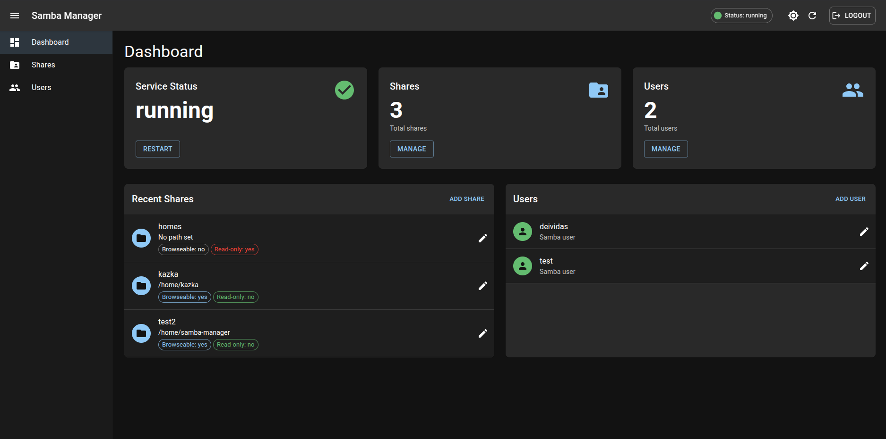

# Samba Manager

A web interface and API for running a Samba file server that Windows, macOS and Linux
machines can all use. Run it **in Docker** or as a **single binary on a Linux VM**.



## What you get

- **Shares** - create a share (folder, who may read, who may write) in one step; the folder, its permissions and `smb.conf` are handled together, and a failed save leaves nothing half-done.
- **Two access models, chosen per share**
  - *Samba-only*: Samba enforces `valid users` / `write list`; every file belongs to one account (`force user`/`force group`).
  - *POSIX ACL*: the filesystem enforces per-user access with Linux ACLs; files keep their real owners.
- **Users and groups** - Samba passwords, Unix accounts and group membership; user home directories.
- **Safe configuration changes** - every change is checked with Samba's own `testparm`, the previous file is backed up (restore from the UI), the new file is written atomically, and Samba is *reloaded* (connected clients are not dropped).
- **Cross-platform ready** - a preset and share templates for Windows, macOS (Finder metadata, Time Machine) and Linux, plus "how to connect" instructions for each share.
- **Monitoring** - dashboard, disk usage per share, connected clients, Samba logs.
- **Hardened by default** - generated admin password (bcrypt), login throttling, strict input validation, shares restricted to allowed directories, optional HTTPS.
- **Survives rebuilds** - users, groups, their IDs and passwords persist across container re-creation.

## Quick start with Docker

```bash
docker compose up -d --build
docker compose logs samba-manager      # shows the generated admin password, once
```

Open <http://localhost:8080>, sign in as `admin` with that password, then create a user and a share.
Set `SAMBA_MANAGER_PASSWORD=...` in your environment (or a `.env` file) to choose the password yourself.

| What | Default | Change with |
|---|---|---|
| Web UI | `8080` | `UI_PORT` |
| SMB | `445` | `SMB_PORT` |
| NetBIOS | `139`, `137/udp`, `138/udp` | `NETBIOS_SESSION_PORT`, `NETBIOS_NS_PORT`, `NETBIOS_DGM_PORT` |
| Workgroup / server name | `WORKGROUP` / `samba-manager` | `SAMBA_WORKGROUP`, `SAMBA_NETBIOS_NAME` |

**Your data** lives in Docker volumes (`samba-data` is mounted at `/srv/samba`). To share an existing
directory, replace the volume with a bind mount in `docker-compose.yml`:

```yaml
      - /mnt/storage:/srv/samba
```

**Discovery.** With the default bridge networking, clients connect by name or address
(`\\server\share`, `smb://server/share`). To make the server show up on its own in Windows
"Network" and the macOS Finder sidebar, use host networking (Linux hosts; free ports 445/139/137/138/8080 first):

```bash
docker compose -f docker-compose.host.yml up -d --build
```

This also starts `wsdd2` (Windows) and Avahi (macOS/Linux).

### Volumes

| Volume | Mount | Contains |
|---|---|---|
| `samba-config` | `/etc/samba` | `smb.conf` |
| `samba-db` | `/var/lib/samba` | Samba password database |
| `manager-state` | `/var/lib/samba-manager` | users/groups list (for restoring accounts with the same IDs), config backups, admin password hash |
| `samba-data` | `/srv/samba` | shared files |
| `samba-homes` | `/home` | user home directories |
| `samba-logs` | `/var/log/samba` | Samba logs (shown in the UI) |

Upgrade: `docker compose up -d --build`. Back up the volumes (at least `samba-db`, `manager-state`, `samba-config`, and your data).

## Install on a VM (one binary, no Docker)

Requirements: a Linux machine with systemd, root access, and these packages
(Samba Manager does not install packages itself):

| Distribution | Command |
|---|---|
| Debian / Ubuntu | `sudo apt install samba samba-vfs-modules acl wsdd2 avahi-daemon` |
| Fedora / RHEL | `sudo dnf install samba samba-common-tools acl avahi` |
| Alpine | `sudo apk add samba acl wsdd2 avahi dbus` |
| Arch | `sudo pacman -S samba acl avahi` |

`wsdd2`/`avahi` are optional (automatic discovery on Windows / macOS). Then:

```bash
# download samba-manager-linux-amd64 (or -arm64) from the releases page, or build it: make build
chmod +x samba-manager-linux-amd64
./samba-manager-linux-amd64 doctor           # lists anything missing
sudo ./samba-manager-linux-amd64 install     # installs binary + systemd service, prints the admin password
```

`install` can be run again at any time with a newer binary: that is the upgrade path. It never overwrites your
config, state or admin password. Other commands:

```text
samba-manager serve        run in the foreground (the systemd service does this)
samba-manager doctor       check dependencies, smb.conf and ACL support
samba-manager install      install / upgrade (--port, --host, --no-start, --force)
samba-manager uninstall    remove service + binary (--purge also removes config and state)
samba-manager version
```

Files: binary `/usr/local/bin/samba-manager`, config `/etc/samba-manager/config.yaml`, state `/var/lib/samba-manager`, logs `journalctl -u samba-manager`.

## Connecting from clients

Every share has a **link icon** in the UI that shows the exact address and commands.

- **Windows**: `\\server\share` in File Explorer (Windows 11 refuses guest logons: use a Samba user).
- **macOS**: Finder > Go > Connect to Server > `smb://server/share`.
- **Linux**: `smb://server/share` in the file manager, or `sudo mount -t cifs //server/share /mnt/share -o username=USER,uid=$(id -u)`.

## Access models

| | Samba-only (default) | POSIX ACL |
|---|---|---|
| Enforced by | Samba (`valid users`, `write list`) | The filesystem (ACLs) + Samba |
| Files on disk belong to | one account (`force user`/`force group`) | the user who created them |
| Also protects against | - | other programs / SSH users on the server |
| Needs | nothing | `acl` package and a filesystem mounted with ACL support |

ACL mode changes ACLs incrementally: entries for users removed from the lists are removed, everything else is left alone.
Tick "apply to existing files" once to push the ACLs onto files that are already in the share.

## Configuration

`config.yaml` (see the one in this repo) is looked for in `$SAMBA_MANAGER_CONFIG`, `/etc/samba-manager/`, `./`, and
`~/.config/samba-manager/`. Environment variables override it:

| Variable | Meaning | Default |
|---|---|---|
| `SAMBA_MANAGER_PORT` / `_HOST` | listen port / address | `8080` / `0.0.0.0` |
| `SAMBA_MANAGER_TLS_CERT` / `_TLS_KEY` | serve HTTPS | off |
| `SAMBA_MANAGER_USERNAME` / `_PASSWORD` | admin login (password: plain or bcrypt hash) | `admin` / generated |
| `SAMBA_CONFIG_PATH` | path of `smb.conf` | `/etc/samba/smb.conf` |
| `SAMBA_MANAGER_ALLOWED_ROOTS` | comma list; shares must live below these | `/srv/samba` |
| `SAMBA_MANAGER_STATE_DIR` | state directory | `/var/lib/samba-manager` |
| `SAMBA_MANAGER_SERVICE_MODE` | `auto`, `systemd` or `process` | `auto` |
| `SAMBA_MANAGER_SUPERVISE` | run smbd/nmbd as children (set in the Docker image) | `false` |
| `SAMBA_MANAGER_NMBD` / `_WSDD` / `_AVAHI` | supervised extras | `true` / `false` / `false` |
| `SAMBA_WORKGROUP`, `SAMBA_NETBIOS_NAME` | used when the first `smb.conf` is generated | `WORKGROUP`, hostname |

If no `smb.conf` exists, a default one is created (standalone server, SMB2+, guests refused, macOS support when `vfs_fruit` is installed).

## Security notes

- The web UI controls a root process. Do not expose it to the internet. Keep it on your LAN/VPN or behind a reverse proxy with TLS (or set `manager.tls`).
- Without a configured password a random one is generated at first start. A password changed in the UI is stored (hashed) in the state directory and **takes precedence over** `SAMBA_MANAGER_PASSWORD`.
  Locked out? Delete `auth.json` in the state directory and restart: a new password is generated (or your configured one is used).
- Five failed logins from one address block it for a minute.
- Share paths must be inside `allowedRoots`; user, group and share names and all parameter values are validated; the raw editor is the only place that accepts free-form `smb.conf`, and it is checked with `testparm` before saving.
- Samba users must have passwords of at least 8 characters.

## Troubleshooting

| Problem | Fix |
|---|---|
| `port is already allocated` on 445/8080 | something else uses it (another Samba?). Set `SMB_PORT` / `UI_PORT`, or stop the other service. Clients on non-445 ports need `smb://host:port/share`. |
| Server not visible in Windows "Network" / Finder | use host networking (`docker-compose.host.yml`) or connect by address. |
| Windows asks for a password again and again | use `server\user` or `.\user`; Windows 11 does not allow guests. |
| New group membership has no effect | connected clients keep the old membership; reconnect. |
| "POSIX ACL" is greyed out | install `acl` and make sure the share directory's filesystem supports ACLs (`samba-manager doctor`). |
| "Samba rejected the configuration" | the message is the `testparm` output; the file was not changed. |

## Development

```bash
make build        # web UI (embedded) + Go binary
make test         # Go tests (-race) and UI tests
make lint         # gofmt + go vet
make e2e          # builds the image and tests HTTP + real SMB access
make dist         # static linux/amd64 + arm64 binaries in dist/
cd gui && npm start   # UI dev server on :3000, proxies /api to :8080
```

`go build` and `go test` work without building the UI (the server then shows a short "UI not built" notice), so Go-only work needs no Node.

```text
main.go, serve.go, install.go, doctor.go    commands
internal/api        HTTP handlers (shares, users, groups, config, monitoring)
internal/smbconf    smb.conf parser/writer, atomic store, backups, default config
internal/system     command runner, validation, users backend, service control, supervisor
internal/state      persisted users/groups for rebuilds
internal/auth       bcrypt auth, throttling
internal/config     manager settings
gui/                React UI
scripts/e2e.sh      end-to-end test
```

Releases: push a tag `vX.Y.Z`; the workflow publishes binaries with checksums and a multi-arch image on GHCR.

## Limitations

Linux servers only (clients can be anything). One admin account for the UI. No Active Directory / domain member mode, quotas or SMB1.

## License

See [LICENSE](LICENSE).
